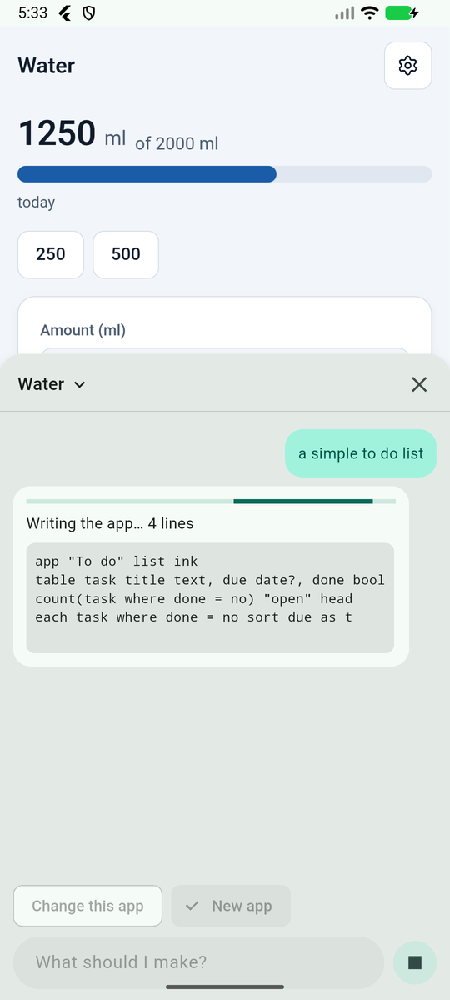
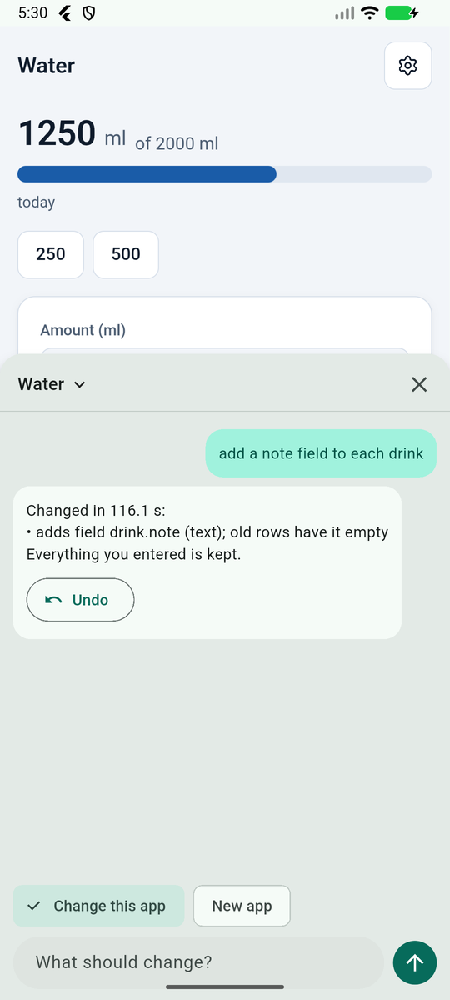
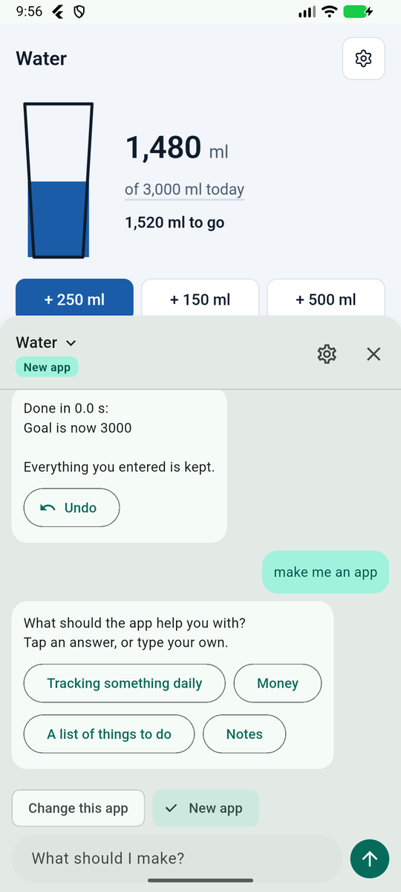
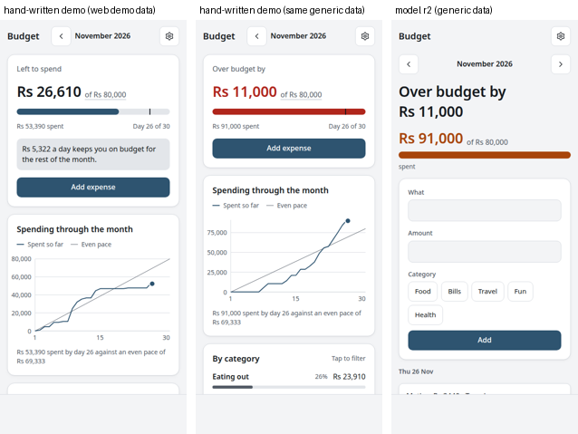
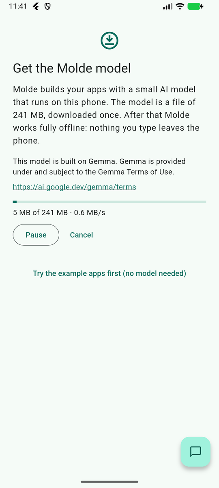
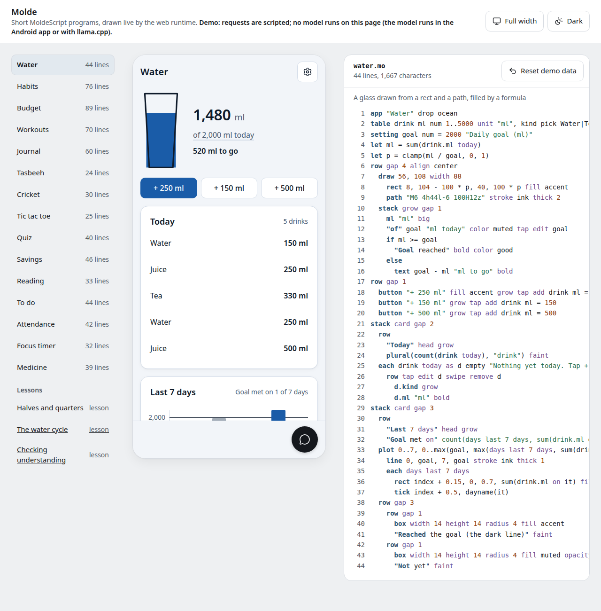

# Molde

**One tiny model, running offline on your phone, that builds small apps from a chat and changes them when you ask.**

Say "track how many glasses of water I drink" and Molde writes the app, draws it, and keeps your data. Say "add a note to each drink" and it changes the app without losing what you entered. Nothing leaves the phone.

Molde is an idea by Kamal ([oyekamal](https://github.com/oyekamal)), built in the open by [Orenda Project](https://github.com/Orenda-Project). It is **early research software**: it works end to end, and it also makes plenty of mistakes. The numbers below say how many.

| Make an app | Change it, with Undo | It asks when unsure |
|---|---|---|
|  |  |  |

## How it works

The model does not write HTML or JavaScript. It writes **MoldeScript**, a small strict language made for this one job. A whole app is usually 10 to 40 short lines:

```
app "Reading log" book ink
table page_log title text, mins num 1..600, pages num 1..500
form page_log
daybars last 7 days, sum(page_log.pages on it)
list page_log by day
remind "Time to add reading" at 21:00
```

(That program was written by the r2 model on a laptop for "a reading log: book title, pages read each day, and a chart of pages over the last 7 days".)

1. A grammar guides the model while it writes, so the syntax is always right. A line-by-line decoder also stops it from using names that do not exist.
2. A type checker reads the program. If it fails, the app keeps the last good version.
3. A runtime draws the program as a real screen. The model's text is never run as code.
4. Changes are checked against every earlier version of the app: a field is hidden, never dropped, so your saved data survives every change.

Because the language is so small, a 270M-parameter model (about 240 MB on disk) is enough to learn it.

## Where it stands (honest numbers)

Recommended default: **r3 Gemma 270M** (241 MB, fast, about 2 s per app on a laptop CPU). Optional: **r4 Qwen3.5-0.8B, epoch 1** (504 MB, ChatML prompt; higher quality, slower, for phones with 6 GB or more). This matches `models.json`. Both use the line-stepped decoder. r4 (dataset v3.1, 20.9k pairs) files are on Hugging Face (`oyekamal/molde-tiny`); epochs other than the ones in the table are uploaded but not yet tested.

On the fixed test set (149 requests heldout2, 60 short named requests, 40 small changes through the app's own loop; laptop CPU, rough speeds):

| | **r3 Gemma 270M (default)** | r4 Gemma 270M (epoch 2) | r4 Qwen 0.8B (epoch 1, optional) |
|---|---|---|---|
| heldout2: program passes the checker | 90.6% | 89.3% | **94.6%** |
| asks a question instead of building a short request | 31.7% | 21.7% | **11.7%** |
| short requests built through the app (of 60) | **59** | 53 | 56 |
| small changes that did what was asked (of 40) | 14 | 16 | **22** |
| seconds per new app / per small change | 2.3 / 5.6 | 3.2 / 5.0 | 4.3 / 11 |

**Read the 90.6% with care.** The heldout2 row measures program validity: the program passes the checker. It does not measure whether the app does what was asked. On a separate failure hunt with 407 brand-new requests, r3 Gemma built exactly what was asked 37% of the time (71% leniently), and 87.7% of the programs were valid. Use 37% / 71% as the honest new-request figure for r3 Gemma.

The r2 numbers below are the older measurement on 140 new app ideas.

**140 new app ideas** that the model never saw, written to sound like real people (trackers, lists, counters, calculators, timers, changes to existing apps):

| | r1 | r2 | hand-written reference |
|---|---|---|---|
| program is valid and runs | 76% | **81%** | 100% |
| app works when used (add a row, see it) | 66% | **78%** | 97% |
| must-have features present | 30% | **42%** | 99% |
| every must-have present | 2% | **7%** | 96% |
| median seconds per app (laptop CPU) | 9.1 | **3.7** | |

On the fixed test set of 149 requests (heldout2), r2 passes the checker on 90.6% (creates 87%, edits 100%, asks 100%, out-of-scope 90%).

What does **not** work well yet:

- **Apps look plain.** The model copies the simple look of its training data, so its apps are far less rich than hand-written ones (see the picture below).
- **Small changes to long apps** often drop sections of the app. Only about 1 in 4 small changes were fully correct in one test.
- **Must-haves.** A valid app often misses part of what was asked (42% of must-haves met).
- **Very short requests** ("todo", "budget") sometimes make the model ask a question first instead of building.
- **English only.** The language cannot make games or call the internet.
- Speed on a real low-end phone is not measured yet; the emulator is slow (about 100 s per app), a laptop CPU takes about 4 s.

Dataset v3 targets the first three problems; r3 and r4 were trained on it. A 2B run (Qwen3.5-2B) was stopped early; its partial weights are on Hugging Face (`r4-qwen35-2b-partial`), untested.



*Left two: hand-written MoldeScript. Right: what the r2 model made for the same request. Valid and working, but plainer.*

## Try it

### 1. Android app (easiest)

1. Download the APK from the [v0.3.0 release](https://github.com/Orenda-Project/molde/releases/tag/v0.3.0):
   - `molde-0.3.0-arm64-v8a-debug.apk` for a real phone (most Android phones from the last 6 years),
   - `molde-0.3.0-x86_64-debug.apk` for the Android emulator on a PC.
2. Install it (allow "install unknown apps" for your browser or file manager), or `adb install molde-0.3.0-arm64-v8a-debug.apk`.
3. Open it. It downloads the model (241 MB) once from Hugging Face, then works fully offline. Without the model you can still open the example apps.
4. Tap the chat button and describe an app, or pick an example and ask for a change.

These are debug builds, not signed for the Play Store. A phone with 3 GB of memory or more is recommended.



### 2. The model on a laptop with llama.cpp

Tested on Linux with llama.cpp build b12144. Any recent build works; on a Mac, `brew install llama.cpp`.

```bash
# llama.cpp (Linux x64 build; other systems: https://github.com/ggml-org/llama.cpp/releases)
curl -L -o llama.tar.gz https://github.com/ggml-org/llama.cpp/releases/download/b12144/llama-b12144-bin-ubuntu-x64.tar.gz
mkdir llama && tar xzf llama.tar.gz -C llama
LLAMA=$(dirname "$(find "$PWD/llama" -name llama-completion -type f | head -1)")

# the model (241 MB) and the grammar
curl -L -o molde-r2-q4.gguf https://huggingface.co/oyekamal/molde-tiny/resolve/main/r2-gemma270m/r2-gemma270m-Q4_K_M.gguf
curl -L -o moldescript.gbnf https://raw.githubusercontent.com/Orenda-Project/molde/main/lang/moldescript.gbnf

# the prompt (Gemma chat format; the system text is the one the model was trained with)
cat > prompt.txt <<'EOF'
<start_of_turn>user
You write MoldeScript, a tiny language for small phone apps. Reply with the complete program only, no explanation. For an edit request you get the current program: reply with the full updated program.

Request: a reading log: book title, pages read each day, and a chart of pages over the last 7 days<end_of_turn>
<start_of_turn>model
EOF

LD_LIBRARY_PATH=$LLAMA $LLAMA/llama-completion -m molde-r2-q4.gguf --grammar-file moldescript.gbnf \
  -f prompt.txt -n 600 --temp 0 -no-cnv --no-display-prompt 2>/dev/null | sed '/\[end of text\]/d' > app.mo
cat app.mo
```

Check the program and read it in plain English (Node 20 or newer, no `npm install`; run from a clone of this repo):

```bash
git clone https://github.com/Orenda-Project/molde && cd molde
node lang/mo.mjs check ../app.mo      # OK, or each error with its line and a fix
node lang/mo.mjs describe ../app.mo   # what the app keeps and shows
node lang/mo.mjs tree ../app.mo       # the UI tree a renderer draws
```

For an edit, use `Edit request: <what to change>\n\nCurrent program:\n<the program>` as the user text. This simple command uses only the grammar. The app and the numbers above also use the line-by-line name decoder (branch `phase-2-decode`), which gives clearly better results.

### 3. The web demo (no install)

[Open the demo](https://orenda-project.github.io/molde/demo/) to see 15 hand-written MoldeScript apps drawn live by the web runtime, with the program next to each one. Changes in the demo chat are scripted; no model runs in the browser. A second page, [lessons](https://orenda-project.github.io/molde/demo/molde-lessons.html), shows where the project is heading: lesson screens that a learner or teacher reshapes by chat.



## Links

- Model: [huggingface.co/oyekamal/molde-tiny](https://huggingface.co/oyekamal/molde-tiny) (GGUF, Q4_K_M and Q8_0)
- Dataset: [huggingface.co/datasets/oyekamal/molde-data](https://huggingface.co/datasets/oyekamal/molde-data) (v1, v2, v3)
- Train your own or improve the data: [TRAINING.md](TRAINING.md)
- Help out: [CONTRIBUTING.md](CONTRIBUTING.md)
- The plan and the reasons behind it: [docs/PLAN.md](docs/PLAN.md)

## Repo map

`main` holds what a newcomer needs. Active work happens on branches and is merged when it passes review.

| Path / branch | What |
|---|---|
| `lang/` | MoldeScript: spec, grammar (`moldescript.gbnf`), parser, type checker, formatter, evaluator, CLI `mo.mjs`, tests |
| `train/` | dataset builder, fine-tuning, GGUF export, evaluation and scoring |
| `docs/` | plan, process, images, the web demo |
| branch `phase-0-language` | language work in progress |
| branch `phase-1-renderer` | the web runtime that draws programs (`runtime/`) |
| branch `phase-2-decode` | the line-stepped constrained decoder and its report |
| branch `phase-2-train` | training work in progress |
| branch `phase-4-app` | the Flutter Android app |
| branch `data` | dataset generators, reports and verdicts |
| branch `eval-novel` | the 140-idea evaluation, judge prompts and results |

## Licence

- Code, the MoldeScript language and its documentation: [Apache License 2.0](LICENSE).
- Model weights: fine-tuned from Gemma 3 270M, so they follow the [Gemma Terms of Use](https://ai.google.dev/gemma/terms) and the [Gemma Prohibited Use Policy](https://ai.google.dev/gemma/prohibited_use_policy).
- Dataset: [CC BY 4.0](https://creativecommons.org/licenses/by/4.0/). It is synthetic: requests and programs were written by large language models and by scripts, then every program was checked by the MoldeScript checker.

Copyright 2026 Muhammad Kamal (oyekamal) and Orenda Project.
